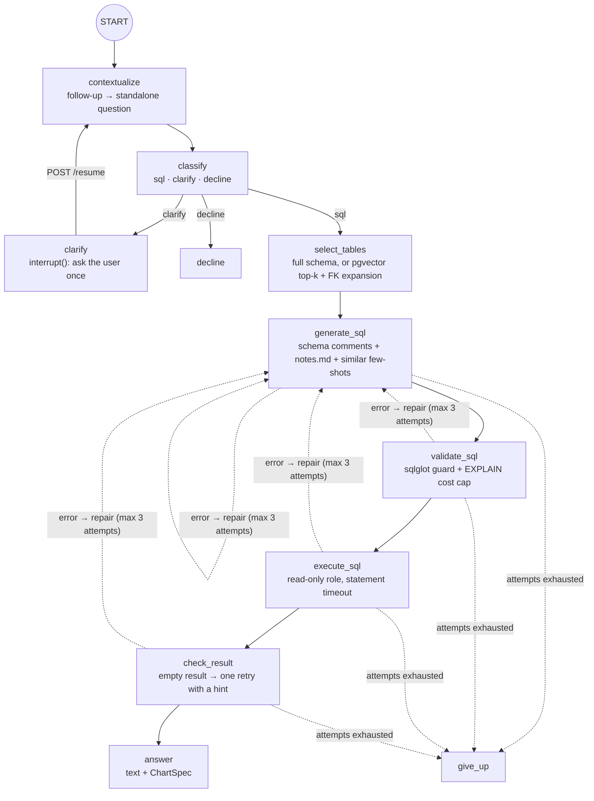
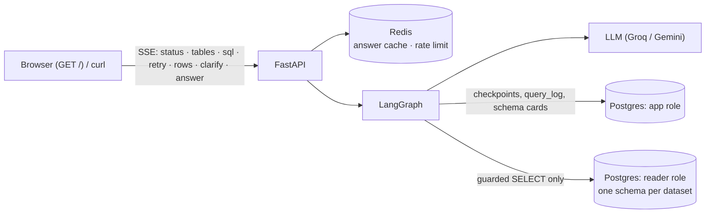

# AskData

Ask questions about any dataset you load, in plain English, and get a **verified** answer: the
answer, the SQL that produced it, the rows and a chart. A LangGraph agent picks the relevant
tables, writes PostgreSQL, checks it with a SQL parser and `EXPLAIN`, runs it as a **read-only**
database role, repairs itself when something fails (max 3 attempts), asks when a question is
ambiguous, and remembers the conversation so follow-ups ("now only finals") work.

IPL cricket (Cricsheet, 1,243 matches, 2008–2026) is the benchmark dataset; a synthetic retail
`sales` dataset runs on the same code with no changes. Any CSV/Parquet dataset plugs in with one
`dataset.yaml` (see [Add your own dataset](#add-your-own-dataset-in-5-steps)).

<!-- RESULTS:START -->
## Results

Measured on the golden sets in `datasets/<name>/golden.yaml` (every gold query written and
verified by hand) with `evals/run_evals.py`. Results are filled in below from `evals/results/`.
<!-- RESULTS:END -->

## How it works





**Safety is layered, and no layer trusts the model:** `classify` declines off-topic and
injection attempts → the `guard()` parses the SQL with sqlglot and allows one SELECT on the
thread's own dataset schema only (no system catalogs, no functions like `pg_sleep`/`pg_read_file`,
`LIMIT` added) → `EXPLAIN` rejects expensive plans before they run → the reader role has
`SELECT` on dataset schemas only, no `TEMP`, read-only transactions and a 5 s timeout → API key +
Redis rate limit. The red-team suite (`make redteam`) runs 12 attacks against the guard **and**
directly against the database role, so each layer is tested alone.

## Quickstart

```bash
cp .env.example .env            # LLM_MODEL + GROQ_API_KEY, DB passwords, API_KEYS
make stack                      # docker: postgres + redis + api; loads ipl + sales on first start
open http://localhost:8000      # demo page (enter one of API_KEYS)
```

Local development (API on the host, databases in docker):

```bash
make up && make data            # postgres + redis, migrate, fetch + load ipl
make load DATASET=sales
make dev                        # uvicorn with reload on :8000
make test                       # 300+ tests: unit, graph (scripted LLM), red-team, API integration
```

### API

```bash
TID=$(curl -s -X POST localhost:8000/api/v1/threads -H "X-API-Key: dev-key" \
  -H "Content-Type: application/json" -d '{"dataset":"ipl"}' | jq -r .thread_id)
curl -N -X POST localhost:8000/api/v1/threads/$TID/ask -H "X-API-Key: dev-key" \
  -H "Content-Type: application/json" -d '{"question":"Top 5 run scorers of all time"}'
curl -N -X POST localhost:8000/api/v1/threads/$TID/ask -H "X-API-Key: dev-key" \
  -H "Content-Type: application/json" -d '{"question":"Only in finals"}'          # follow-up
curl -N -X POST localhost:8000/api/v1/threads/$TID/ask -H "X-API-Key: dev-key" \
  -H "Content-Type: application/json" -d '{"question":"Who is the best player?"}' # → clarify
curl -N -X POST localhost:8000/api/v1/threads/$TID/resume -H "X-API-Key: dev-key" \
  -H "Content-Type: application/json" -d '{"reply":"most wickets"}'
```

| Endpoint | |
|---|---|
| `POST /api/v1/threads` | new conversation bound to one dataset |
| `POST /api/v1/threads/{id}/ask` · `/resume` | SSE stream of one turn |
| `GET /api/v1/threads/{id}` | history, last SQL, pending clarifying question |
| `POST /api/v1/ask` | non-streaming, returns the final JSON |
| `POST /api/v1/queries/{id}/feedback` | 👍 / 👎 on an answer (`{"rating": 1 \| -1}`) |
| `GET /api/v1/datasets` · `/datasets/{name}/schema` | what can be asked |
| `GET /` | demo page: streams the events, draws the chart (Chart.js) |

A thread's first question is cached in Redis for an hour (key: dataset + dataset version +
normalized question + model), so a repeated question costs no LLM call; reloading a dataset
changes its version and with it every key.

## Evals

```bash
make eval DATASET=ipl                                   # golden test split → evals/results/*.json
make eval DATASET=ipl ARGS="--attempts 1 --label e1"    # one experiment
make experiments DATASET=ipl                            # baseline + E1–E4
uv run python evals/rescore.py evals/results/<file>.json   # re-score after a metric change, no LLM
```

The runner calls the same graph, guard and reader role as the API (in-process, a fresh thread
per question) and records outcome, attempts, latency and tokens per question. **Execution
accuracy** compares result sets, not SQL text: row and column order are ignored, text is
case-insensitive, numbers match within ±0.051 (gold SQL rounds to 1 dp). *Strict* requires the
same columns; *relaxed* accepts extra columns (e.g. `name, wins` when the gold returns `name`).
`--langsmith` also uploads the golden set and the scored run as a LangSmith experiment.

## Add your own dataset in 5 steps

1. `mkdir -p datasets/<name>/raw` and copy the CSV/Parquet files in.
2. Write `datasets/<name>/dataset.yaml`: title, description, tables, primary and foreign keys,
   and comments for anything a newcomer would misread (codes, units, currency).
3. `make load DATASET=<name>`: types are inferred, keys checked, the schema created and granted
   to the reader role in one transaction.
4. Add `notes.md` (domain rules) and 3–8 verified `fewshots.yaml` examples.
5. Add 15+ `golden.yaml` questions with verified SQL and run `make eval DATASET=<name>`.

Steps 1–3 make it work; 4–5 make it accurate. No code changes: CI fails if `src/` mentions a
dataset by name.

## Repo layout

```
db/            role setup (init) + numbered SQL migrations
datasets/      one folder per dataset: dataset.yaml, notes.md, fewshots.yaml, golden.yaml
scripts/       loader, schema indexer, migrations, container bootstrap
src/ask_data/  FastAPI app, LangGraph graph, SQL guard + executor, demo page (web/)
evals/         run_evals.py, metrics.py, rescore.py, LangSmith upload
tests/         unit / graph / integration / redteam
```

Data: IPL ball-by-ball data from [Cricsheet](https://cricsheet.org/) (ODC-BY).
